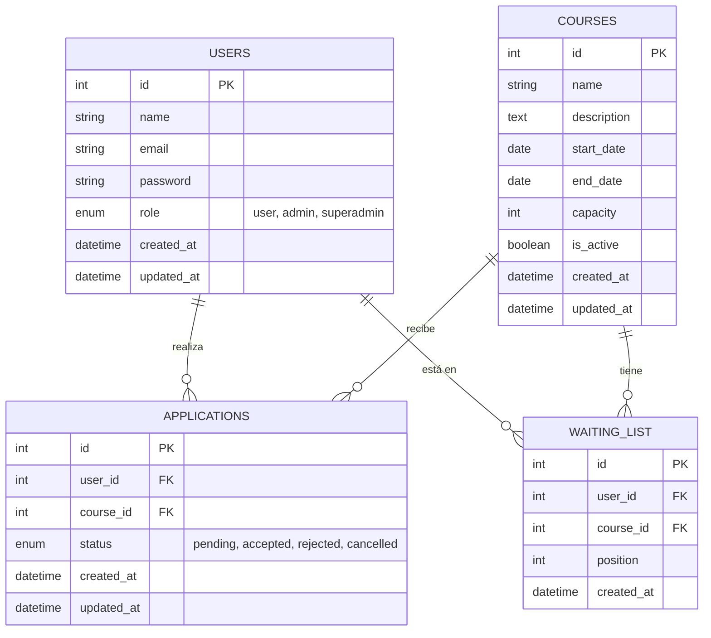
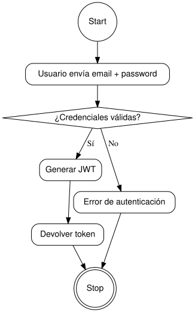

# README – Backend CourseFlow (FastAPI + PostgreSQL + Alembic + Docker)

Proyecto disponible en https://courseflow-8auy.onrender.com

1. Introducción
Este backend implementa la API del proyecto CourseFlow, una plataforma para gest
ionar cursos, solicitudes de inscripción y listas de espera.
Está construido con:
• FastAPI (framework principal)
• SQLAlchemy (ORM)
• PostgreSQL (base de datos)
• Alembic (migraciones)
• Docker + docker‑compose (entorno reproducible)
• JWT (autenticación)
• Arquitectura modular y escalable
La estructura está adaptada a las necesidades del bootcamp y a la organización r
eal del equipo.
---
2. Estructura del proyecto
Esta es la estructura actual del repositorio backend:

```text
CourseFlow_Backend/
├── src/                          # Código fuente del proyecto
│   └── app/                      # Aplicación principal FastAPI
│       ├── __init__.py
│       ├── main.py               # Punto de entrada de FastAPI
│       ├── config.py             # Configuración heredada
│       ├── alembic/              # Directorio de configuración de Alembic
│       │   └── env_1.py          # Script de entorno de migraciones
│       ├── api/                  # Controladores y endpoints de la API
│       │   ├── deps.py           # Dependencias comunes (ej. get_db)
│       │   └── v1/               # Versión 1 de la API REST
│       │       ├── routes_auth.py       # Rutas de login y logout con JWT
│       │       ├── routes_users.py      # Rutas de registro y perfil de usuario
s
│       │       ├── routes_courses.py    # Rutas de CRUD de cursos
│       │       ├── routes_applications.py # Rutas de solicitudes de inscripción
│       │       └── routes_waiting_list.py # Rutas de la lista de espera
│       ├── core/                 # Configuración de seguridad y entorno
│       │   ├── config.py         # Carga de variables de entorno (.env)
│       │   └── security.py       # Utilidades de seguridad (hashing y JWT)
│       ├── db/                   # Inicialización de la base de datos
│       │   ├── base.py           # Base declarativa de SQLAlchemy
│       │   └── session.py        # Configuración del engine y sessionmaker
│       ├── models/               # Modelos SQLAlchemy (Base de Datos)
│       │   ├── __init__.py
│       │   ├── user.py           # Entidad y relaciones de usuarios
│       │   ├── course.py         # Entidad y relaciones de cursos
│       │   ├── application.py    # Entidad de solicitudes de cursos
│       │   └── waiting_list.py   # Entidad de lista de espera
│       ├── schemas/              # Esquemas de validación Pydantic
│       │   ├── __init__.py
│       │   ├── user_schema.py    # Validación de datos de usuarios
│       │   ├── course_schema.py  # Validación de datos de cursos
│       │   ├── auth_schema.py    # Validación de credenciales y tokens
│       │   └── application_schema.py # Validación de solicitudes de cursos
│       ├── routes/               # Rutas heredadas (sin uso actual)
│       │   ├── __init__.py
│       │   ├── auth.py
│       │   ├── courses.py
│       │   └── applications.py
│       └── utils/                # Utilidades y funciones auxiliares
│           ├── __init__.py
│           └── decorators.py     # Decoradores personalizados
├── tests/                        # Suite de pruebas unitarias e integración
│   ├── conftest.py               # Fixtures globales de pytest
│   ├── test_admin.py             # Pruebas de rutas de administración
│   ├── test_auth.py              # Pruebas del flujo de autenticación
│   ├── test_auth_middleware.py   # Pruebas de roles y middleware
│   ├── test_courses.py           # Pruebas del CRUD de cursos
│   ├── test_health.py            # Prueba de salud/disponibilidad del servidor
│   ├── test_users.py             # Pruebas de perfiles de usuario
│   └── test_applications.py      # Pruebas de solicitudes de inscripción
├── docs/                         # Documentación organizada del proyecto
│   ├── assets/                   # Diagramas generales y de secuencia (SVG/PNG)
│   ├── guides/                   # Guías de despliegue, estructura y testing
│   ├── lineamientos/             # PDFs de lineamientos del bootcamp
│   └── stories/                  # Historias de usuario del backlog
├── Dockerfile                    # Receta de la imagen Docker de la API
├── docker-compose.yml            # Orquestación de servicios (FastAPI + Postgre
s)
├── requirements.txt              # Dependencias del backend
├── README.md                     # Documentación principal del repositorio
└── .env.example                  # Plantilla para variables de entorno
```

3. Explicación de cada carpeta
`app/main.py`
Punto de entrada de FastAPI.
Aquí se inicializa la app, CORS y se incluyen las rutas.
---
`app/api/`
Contiene toda la lógica de la API.
`api/deps.py`
Dependencias comunes, como la sesión de DB (get_db()).
`api/v1/`
Rutas organizadas por módulo:

| Archivo | Función |
|---------|----------|
| routes_auth.py | Login, JWT |
| routes_users.py | Registro y gestión de usuarios |
| routes_courses.py | CRUD de cursos |
| routes_applications.py | Solicitudes de inscripción |
| routes_waiting_list.py | Lista de espera |

`app/models/`

		Modelos SQLAlchemy que representan las tablas:
		• user.py
		• course.py
		• application.py
		• waiting_list.py
		El archivo models/__init__.py importa todos los modelos para que Alembic pue
da detectarlos.
---
`app/schemas/`

		Schemas Pydantic usados para:
		• Validar datos de entrada
		• Formatear respuestas
		• Documentar la API


| Archivo | Contenido |
|---------|----------|
| user_schema.py | UserCreate, UserRead |
| auth_schema.py | LoginRequest, TokenResponse |
| course_schema.py | CourseCreate, CourseRead |
| application_schema.py | ApplicationCreate, ApplicationRead |
| waiting_list_schema.py | WaitingListCreate, WaitingListRead |

`app/core/`
Configuración central del backend.

| Archivo | Función / Descripción |
|---|---|
| `core/config.py` | Carga variables de entorno y configuración general. |
| `core/security.py` | Funciones de seguridad: hash de contraseñas, verificación
 y generación de tokens JWT. |

---
`app/db/`
Conexión a la base de datos.

| Archivo | Función / Descripción |
|---|---|
| `session.py` | Crea el engine y la sesión de SQLAlchemy. |
| `base.py` | Define la clase base declarativa para todos los modelos. |

---
`app/alembic/env_1.py`
Este archivo es la configuración de Alembic.
*   **Origen**: Creado automáticamente por Alembic.
*   **Propósito**: Editado para conectar las migraciones con tus modelos de dato
s.
*   **Rol**: Actúa como el "cerebro" que permite generar y aplicar migraciones.

---
`tests/`
Suite de pruebas automáticas con pytest.
*   `test_health.py`: Verifica la respuesta y disponibilidad del servidor de la 
API.
---
4. Base de datos y migraciones (Alembic)

¿Qué es Alembic?
Sistema de migraciones para SQLAlchemy.
¿Dónde está configurado?
En:
app/alembic/env_1.py
¿Cómo generar una migración?**
alembic revision -m "init"
Esto crea un nuevo archivo de migración en app/alembic/versions/.
¿Cómo aplicar migraciones?**
alembic upgrade head
Esto actualiza la base de datos al último estado definido por las migraciones.

### Modelo Relacional de Datos

El sistema utiliza un esquema relacional donde los **Usuarios** se inscriben en 
**Cursos** a través de **Solicitudes** (Applications). Además, existe una **List
a de Espera** para gestionar el cupo de los cursos cuando la capacidad se agota.

#### Diagrama Entidad-Relación (ERD)



#### Descripción de las Relaciones

*   **Usuarios <-> Solicitudes (1:N):** Un usuario puede tener múltiples solicit
udes (una por curso), pero cada solicitud pertenece a un único usuario.
*   **Cursos <-> Solicitudes (1:N):** Un curso puede recibir múltiples solicitud
es de inscripción, pero cada solicitud está vinculada a un único curso.
*   **Relación Muchos a Muchos (M:N):** Los usuarios y los cursos están relacion
ados indirectamente a través de la tabla `applications`, que actúa como tabla de
 unión con metadatos adicionales (el estado de la inscripción).
*   **Lista de Espera:** Vincula usuarios con cursos cuando el cupo eshttps://co
urseflow-8auy.onrender.comtá lleno, manteniendo un orden secuencial mediante el 
campo `position`.

### 5. Docker y docker-compose

### Paso a Paso para Levantar el Proyecto

1. **Construir y levantar los contenedores en segundo plano**:
	 ```bash
	docker compose up --build -d
	 ```
	 *Esto construye la imagen, inicia PostgreSQL, ejecuta las migraciones de Alem
bic automáticamente a través del entrypoint y levanta el servidor FastAPI.*

2. **Cargar los datos iniciales de prueba (Semilla)**:
	 Una vez que los contenedores estén activos y la base de datos esté lista, eje
cuta el script de población:
	 ```bash
	docker compose exec backend python scripts/seed.py
	 ```

Si `docker compose down` no logra detener un contenedor por permisos del daemon,
 usa el apagado seguro:
```bash
bash scripts/docker_down_safe.sh
```

Si sospechas estado residual de Docker (cache/redes/containers de jornadas anter
iores), ejecuta limpieza de cache al apagar:
```bash
bash scripts/docker_down_safe.sh --clear-cache
```

Para limpieza profunda (incluye volumenes no usados):
```bash
bash scripts/docker_down_safe.sh --deep-cache
```

Si al levantar aparece `failed to bind host port ... 5434 ... address already in
 use`, significa que ese puerto ya está ocupado por otro servicio en tu host (no
 necesariamente por este compose). Puedes arrancar el stack con otro puerto:
```bash
DB_PORT=5435 docker compose up --build -d
```

También puedes fijar `DB_PORT` en tu archivo `.env` para no repetir el comando.

### Exportación a Excel (cambio incorporado)
Se añadió una funcionalidad para exportar el listado de solicitudes desde el backend.

Endpoint:

GET /api/v1/applications/export/excel

Devuelve un archivo .xlsx con las columnas principales de las solicitudes. El archivo se entrega con cabecera
Content-Disposition y nombre sugerido solicitudes_YYYY-MM-DD.xlsx.

### 🌐 Servicios Incluidos y Puertos Expuestos

*   **backend** → FastAPI y Documentación de la API:
	*   **Swagger UI:** [http://localhost:8002/docs](http://localhost:8002/docs) *
(o el valor de `BACKEND_PORT` en tu `.env`) *
	*   **ReDoc:** [http://localhost:8002/redoc](http://localhost:8002/redoc)
*   **db** → PostgreSQL:
		*   **Puerto interno (Docker net):** `5432`
	*   **Puerto externo (Host):** `5434` por defecto *(configurable con `DB_PORT`
)*
*   **pgadmin** → Interfaz gráfica para gestionar la base de datos:
	*   **Acceso web:** [http://localhost:5052](http://localhost:5052) *(o el valo
r de `PGADMIN_PORT` en tu `.env`) *
		*   **Usuario:** `admin@admin.com`
		*   **Contraseña:** `admin`

### Autoinstalación (Bootstrap) del Superadmin
El sistema cuenta con un mecanismo de autoinstalación para el rol `superadmin`. 
Al arrancar el servidor, FastAPI leerá las siguientes variables de entorno:
- `SUPERADMIN_EMAIL`: Correo electrónico del superadministrador por defecto.
- `SUPERADMIN_PASSWORD`: Contraseña del superadministrador.

Si están presentes en el entorno (configuradas en el archivo `.env`) y no existe
 ningún usuario con rol `superadmin` en la base de datos, se creará automáticame
nte la cuenta de superusuario.

### Configuración de Conexión en pgAdmin (Paso a Paso)
Una vez que ingreses a PgAdmin a través de `http://localhost:5052` usando las cr
edenciales por defecto, sigue estos pasos para conectarte a la base de datos del
 proyecto:

1. Haz clic derecho en **Servers** -> **Register** -> **Server...**
2. En la pestaña **General**:
	 - **Name:** Escribe `CourseFlow DB` (o el nombre que prefieras).
3. En la pestaña **Connection**:
	 - **Host name/address:** Escribe `db` *(nombre del servicio de base de datos 
en docker-compose, resuelto internamente por Docker)*.
	 - **Port:** `5432`
	 - **Maintenance database:** `courseflow_db`
	 - **Username:** `courseflow`
	 - **Password:** `courseflow`
4. Haz clic en **Save** (Guardar).

¡Listo! Ya podrás explorar las tablas de usuarios, cursos y solicitudes creadas 
por las migraciones de Alembic e inspeccionar los datos iniciales cargados por l
a semilla.

	6. Autenticación (JWT)
El flujo:
1. Usuario se registra (POST /api/v1/users)
2. Usuario inicia sesión (POST /api/v1/auth/login)
3. El backend genera un JWT
4. El frontend lo guarda y lo envía en cada petición.

#### Diagrama de Secuencia de Autenticación


 7. Endpoints principales

| Módulo | Método | Endpoint | Rol Mínimo | Descripción |
|---|---|---|---|---|
| **Autenticación** | POST | `/api/v1/auth/login` | Público | Inicia sesión y es
tablece la cookie `access_token` (HttpOnly). |
| | POST | `/api/v1/auth/logout` | Público | Cierra sesión y revoca/añade a list
a negra el token. |
| **Usuarios** | POST | `/api/v1/users` | Público | Registro de nuevos usuarios 
alumnos. |
| | GET | `/api/v1/users/me` | `user` | Obtiene la información del perfil del us
uario autenticado. |
| | PATCH | `/api/v1/users/me` | `user` | Actualiza la información propia del pe
rfil (nombre, email, DNI, edad). |
| **Cursos** | POST | `/api/v1/courses` | `admin` | Crea un nuevo curso. |
| | GET | `/api/v1/courses` | `user` | Lista los cursos activos (los admins ven 
también inactivos). |
| | GET | `/api/v1/courses/{id}` | `user` | Detalle de un curso específico. |
| | PUT | `/api/v1/courses/{id}` | `admin` | Actualiza los datos de un curso. |
| | DELETE | `/api/v1/courses/{id}` | `admin` | Borrado lógico de un curso (marc
a `is_active = False`). |
| | GET | `/api/v1/courses/{id}/applications` | `admin` | Obtiene el listado de 
solicitudes para un curso con datos del alumno. |
| **Solicitudes** | POST | `/api/v1/applications` | `user` | Crea una postulació
n a un curso. |
| | GET | `/api/v1/applications/me` | `user` | Lista las solicitudes de inscripc
ión propias del alumno. |
| | PATCH | `/api/v1/applications/{id}/status` | `admin` | Acepta o rechaza una 
postulación (`accepted`, `rejected`). |
| | DELETE | `/api/v1/applications/{id}` | `user` / `admin` | **Ruta Dual:** Can
celación lógica (alumno) o borrado físico (admin). |
| **Gestión (Superadmin)** | POST | `/api/admin/users` | `superadmin` | Registra
 a un nuevo administrador. |
| | GET | `/api/admin/users` | `superadmin` | Lista los administradores registra
dos. |
| | PATCH | `/api/admin/users/{id}` | `superadmin` | Modifica datos de un admini
strador. |
| | DELETE | `/api/admin/users/{id}` | `superadmin` | Elimina a un administrador
. |
| **Lista de Espera** | POST | `/api/v1/waiting_list` | `user` | Registra a un u
suario en la lista de espera de un curso. |
| | GET | `/api/v1/waiting_list` | `admin` | Lista los registros de la lista de 
espera global. |
| | GET | `/api/v1/waiting_list/{id}` | `admin` | Detalle de un registro de list
a de espera. |
| | GET | `/api/v1/waiting-list/{course_id}` | `user` | Consulta la lista de esp
era de un curso específico. |

### 🧪 Ejemplos de Comandos cURL para Pruebas (Importables en Postman)

Puedes copiar y pegar estos comandos en tu terminal, o importarlos directamente 
en **Postman** (File -> Import -> Paste Raw Text / cURL).

> [!NOTE]
> Dado que la autenticación utiliza cookies seguras `HttpOnly` (`access_token`),
